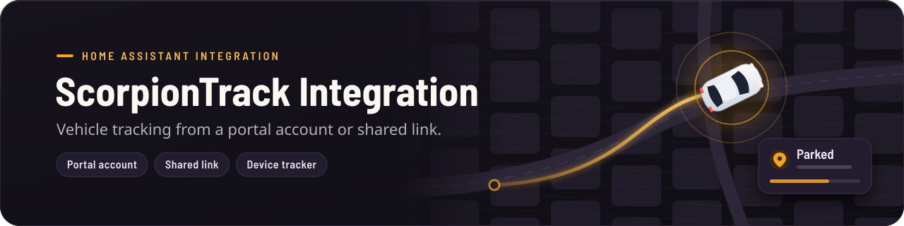

<div align="center">



# ScorpionTrack Portal

Add ScorpionTrack portal accounts, alerts and controls to Home Assistant, alongside the built-in ScorpionTrack integration.

[](https://github.com/Herbertmt978/HA-ScorpionTrack-Integration/actions/workflows/validate.yml)
[](https://github.com/Herbertmt978/HA-ScorpionTrack-Integration/actions/workflows/hassfest.yml)
[](https://github.com/Herbertmt978/HA-ScorpionTrack-Integration/actions/workflows/python-quality.yml)
[](https://github.com/Herbertmt978/HA-ScorpionTrack-Integration/releases)
[](LICENSE)

[](https://my.home-assistant.io/redirect/hacs_repository/?owner=Herbertmt978&repository=HA-ScorpionTrack-Integration&category=integration)

[Choose an integration](#choose-the-right-integration) | [Install](#installation) | [Upgrade](#upgrade-to-050) | [Set up](#setup) | [Examples](#use-cases-and-examples) | [Update or remove](#update-roll-back-or-remove) | [Privacy](#security-and-privacy) | [Support](#troubleshooting)

</div>

## Choose the right integration

Home Assistant includes a built-in ScorpionTrack integration, installed from
**Settings → Devices & services → Add integration**. It uses ScorpionTrack's
shared-location API and is the right choice when read-only tracking is enough.

ScorpionTrack Portal is a separate custom integration with its own
`scorpiontrack_portal` domain, so you can install and run it alongside the
built-in integration. It adds portal-account login, account alerts, richer
vehicle entities and verified portal controls, and it also supports
shared-location links.

Portal-account mode is kept out of Home Assistant Core because it signs in through
the ScorpionTrack web portal's login route. That route is private web behaviour
rather than a documented API, so it is less stable than the shared-location API
used by the built-in integration. Hybrid mode joins the two: the portal provides
account data, alerts and controls, while an optional share provides faster live
positions.

| Capability | Built-in ScorpionTrack | ScorpionTrack Portal |
| --- | --- | --- |
| Integration domain | `scorpiontrack` | `scorpiontrack_portal` |
| Installation | Home Assistant's integration screen | HACS custom repository or manual copy |
| Data source | Shared-location API | Portal login, plus the shared-location API when a share is added |
| Shared-location links | Yes | Yes |
| Portal account login | No | Yes |
| Account alerts and `Mark Alerts Read` | No | Yes |
| Richer vehicle entities, such as odometer, battery voltage and MOT due | No | Yes |
| Verified portal controls | No | `Privacy Mode` and `Zero-Speed Mode` |

Both integrations can be configured at the same time. Avoid adding the same
share to both, or each vehicle will appear twice.

The source and review history for the built-in integration are available in [Herbertmt978/ScorpionTrack-Integration](https://github.com/Herbertmt978/ScorpionTrack-Integration). Install that version from Home Assistant's integration screen, not from its source repository.

> [!IMPORTANT]
> Versions 0.3.x and earlier were called ScorpionTrack Integration and used the built-in `scorpiontrack` domain, replacing the built-in integration while installed. If you are updating from one of those versions, follow [Upgrade from ScorpionTrack Integration 0.3.x](#upgrade-from-scorpiontrack-integration-03x). Make a Home Assistant backup before installing, updating or removing either integration.

## Before you install

| Concern | Behaviour |
| --- | --- |
| Minimum Home Assistant version | 2026.8.0 |
| Data stored by Home Assistant | Portal email and password, a shared-location token, or both for hybrid mode |
| Network access | ScorpionTrack cloud and portal endpoints |
| Polling | Shared links every 2 minutes; portal accounts every 5 minutes; hybrid account live data every 2 minutes |
| Telemetry | No separate analytics or telemetry |
| Writable actions | Mark alerts read, Privacy Mode, and Zero-Speed Mode only |
| Reversibility | Back up first and follow the rollback or removal steps below |

Portal-account mode uses private ScorpionTrack web behaviour rather than a documented public API. Portal changes can temporarily break account mode even when shared-link mode continues to work.

Treat Home Assistant backups as sensitive because they can contain integration configuration.

## Installation

### HACS custom repository

Use the **Open this repository in HACS** button above, or add it manually:

1. Open HACS in Home Assistant.
2. Select `Integrations`.
3. Open the three-dot menu and select `Custom repositories`.
4. Add `https://github.com/Herbertmt978/HA-ScorpionTrack-Integration`.
5. Select `Integration` as the category.
6. Download `ScorpionTrack Portal`.
7. Restart Home Assistant.

<details>
<summary><strong>Manual installation</strong></summary>

1. Download this repository's latest release.
2. Copy `custom_components/scorpiontrack_portal` into Home Assistant's `custom_components` directory.
3. Restart Home Assistant.

Manual installations must be updated manually by replacing the same directory with files from a newer release.

</details>

## Upgrade from ScorpionTrack Integration 0.3.x

Versions 0.3.x and earlier used the built-in `scorpiontrack` domain. Their config entries, devices and entities cannot move to the new `scorpiontrack_portal` domain automatically, so each entry has to be added again. Follow these steps in order:

1. Create a Home Assistant backup.
2. Note how each ScorpionTrack entry is set up: the portal email and any share link. You will need the portal password again.
3. Open `Settings > Devices & services` and delete every entry under `ScorpionTrack Integration`. Deleting them first also removes their old devices and entities, so the new entities can normally reuse the same entity IDs.
4. In HACS, open this repository (listed as `ScorpionTrack Integration`, or `ScorpionTrack Portal` once HACS has refreshed it) and remove the download. Then make sure the `custom_components/scorpiontrack` directory no longer exists, and delete it if it does. While that directory exists, it still replaces the built-in integration.
5. In HACS, select `Update information` on this repository, then download `ScorpionTrack Portal`. For a manual installation, copy `custom_components/scorpiontrack_portal` instead.
6. Restart Home Assistant.
7. Add `ScorpionTrack Portal` and set up each portal account or share again.
8. Check that automations, scripts and dashboards still refer to the right entities. If an entity ID changed, for example by gaining a `_2` suffix, rename it from the entity's settings.

Shared-link entries can instead move to the built-in `ScorpionTrack` integration if you do not need portal features.

If you updated before deleting the old entries, they are left under the built-in integration's domain. Portal-account entries cannot load there, because the built-in integration supports shared-location links only. Delete those entries, check that `custom_components/scorpiontrack` has gone, restart, and add them again under `ScorpionTrack Portal`. Do not edit Home Assistant's `.storage` files manually.

## Upgrade to 0.5.0

Version 0.5.0 adopts Home Assistant Core's conventions for entities. Automations, scripts, templates and dashboards that use removed attributes or entities need updating. Create a backup before you update.

- **From 0.3.x:** follow [Upgrade from ScorpionTrack Integration 0.3.x](#upgrade-from-scorpiontrack-integration-03x). You receive the 0.5.0 entities directly; then use the tables below to update anything that referred to the old ones.
- **From 0.4.0:** update through HACS and restart. Each entry migrates automatically: the share link moves to `Reconfigure`, the speed-unit option is removed, and entities that no longer exist are removed from the entity registry. Existing Speed and Odometer entities keep their current display unit, and entities that are now disabled by default stay enabled on existing installations. To get the default 0.5.0 layout instead, delete the entry and add it again.

### What changed and what to do

| Change | What to do |
| --- | --- |
| State attributes are removed from every entity. | Use the dedicated entities listed in [Replacing removed attributes](#replacing-removed-attributes). |
| Several entities are removed. | See [Replacing removed entities](#replacing-removed-entities). |
| The speed-unit option and the `Configure` dialog are removed. | Speed and Odometer now report km/h and km and are displayed in mph and miles automatically when the account or share uses miles. To change a unit, open the entity's settings and choose a `Unit of measurement`. |
| Status is now a fixed list: `moving`, `parked`, `idle`, `ignition`, `alarm` or `alert` (shared links: `moving`, `parked` or `idle`). Anything else is `unknown`. | Compare against these lowercase values. Hybrid entries previously reported title case, such as `Moving`. |
| Heading reports degrees (`°`) without rounding. | Templates comparing whole numbers may need `round(0)`. |
| Odometer has the distance device class and long-term statistics. | No action needed. |
| Names use sentence case and drop "Active" and "Enabled", for example `Transport mode` and `Armed mode`. | Existing entity IDs are unchanged. New setups get IDs from the new names, such as `binary_sensor.golf_r_transport_mode` instead of `binary_sensor.golf_r_transport_mode_active`. |
| New setups disable Heading, Last service date, Unit last checked in, Backup battery voltage, GPS antenna voltage, GPS antenna current, GPS satellites and GPS HDOP. | Enable any you need from the device page or `Settings > Devices & services > Entities`. |
| Armed mode, EWM, G-Sense and Pending commands are diagnostic entities. | They appear under `Diagnostic` on the device page. Their entity IDs are unchanged. |
| The hybrid share link is changed from `Reconfigure`, not `Configure`. | See [Faster live data for portal accounts](#faster-live-data-for-portal-accounts). |
| Devices for vehicles removed from the account or share are deleted, and recreated if the vehicle returns. | Customisations of a deleted vehicle's entities, such as a renamed entity ID, are lost. |

### Replacing removed attributes

The examples use a vehicle called `golf_r`; replace it with your vehicle's entity ID.

| Removed attribute | Use instead |
| --- | --- |
| `speed`, `speed_kmh`, `speed_unit` | Speed sensor, for example `{{ states('sensor.golf_r_speed') }}` |
| `heading`, `bearing`, `heading_cardinal` | Heading sensor (enable it first) |
| `ignition`, `engine` | Ignition and Engine binary sensors |
| `address`, `formatted_location`, `coordinates` | The tracker's `latitude` and `longitude` attributes, or zones |
| `odometer`, `position_odometer` and their unit attributes | Odometer sensor |
| `vehicle_voltage`, `backup_battery_voltage`, `gps_antenna_voltage`, `gps_antenna_current`, `gps_satellites`, `gps_hdop` | The matching sensors |
| `last_reported`, `position_timestamp`, `last_reported_age_seconds`, `stale` | Last reported sensor, or the Location stale template in [Replacing removed entities](#replacing-removed-entities) |
| `status`, `portal_state`, `position_state` | Status sensor |
| `privacy_mode_enabled`, `zero_speed_mode_enabled` | Privacy mode and Zero-speed mode switches |
| `armed_mode_enabled`, `ewm_enabled`, `g_sense_enabled`, `transport_mode_active`, `garage_mode_active`, `no_alert_mode_active`, `pending_commands_count` | The matching binary sensors |
| `make`, `model` | The device page |
| `registration`, `alias`, `description`, `colour`, `fuel_type`, `battery_type`, `vehicle_type`, `groups`, `unit_type`, `unit_make`, `unit_model`, `installed_at`, `updated_at`, `portal_vehicle_id` | The ScorpionTrack portal |
| `recent_alerts`, `latest_alert` and alert details | Latest alert and Latest alert time sensors |
| `share_title`, `shared_by`, `share_expires`, `created_at`, `vehicle_count`, `distance_units` | Share expires sensor on the share device |
| Account attributes such as `user_id`, `vehicle_ids`, `total_alerts`, `unread_alerts` | Unread alerts sensor |

### Replacing removed entities

| Removed entity | Replacement |
| --- | --- |
| Location (both modes) | The vehicle's device tracker |
| Location stale (both modes) | A template binary sensor, shown below |
| Portal state | Status |
| Pending command count | Pending commands binary sensor |
| Vehicle count, User ID, Last refreshed | None. The number of vehicles is the number of vehicle devices. |
| Installed, Registration, Description, Alias, Colour, Fuel type, Battery type, Make, Model, Vehicle type, Unit make, Unit model | Make and model are on the device page; the other details are in the ScorpionTrack portal. |
| Driver module fitted, Installation complete, Immobiliser fitted | None. These describe fitted hardware and do not change. |
| Share title, Shared by, Share created, and each vehicle's Share expires | The share device's Share expires sensor |

To recreate Location stale, add a template binary sensor (`Settings > Devices & services > Helpers > Create helper > Template > Binary sensor`) with this state template:

```jinja

{{ reported is none or now() - reported > timedelta(hours=24) }}
```

## Verify the installation

After restarting Home Assistant:

1. Open `Settings > Devices & services`.
2. Select `Add integration` and search for `ScorpionTrack Portal`. If the built-in integration is available, it is listed separately as `ScorpionTrack`.
3. Complete one of the setup routes below.
4. Confirm the config entry shows as loaded.
5. Confirm each vehicle has a device and `device_tracker` entity.

Setup performs an initial refresh. Later refreshes run every 2 minutes for shared links and every 5 minutes for portal accounts.

## Supported vehicles

Any vehicle fitted with a ScorpionTrack telematics unit that appears in the ScorpionTrack portal or in a ScorpionTrack location share. One portal account or share can contain several vehicles; each becomes its own device. Controls and some readings depend on the fitted unit and subscription: readings the portal does not report show as unknown, and switches the portal does not report are unavailable.

## Setup

### Portal account

Choose `Portal account` for the fuller authenticated integration. Enter the email address and password used for the ScorpionTrack portal. You may also paste a shared-location URL or token during setup to create one hybrid entry.

Portal-account mode provides an account device and one device per vehicle.

| Entity | Device | Notes |
| --- | --- | --- |
| Unread alerts, Latest alert, Latest alert time | Account | |
| Mark alerts read (button) | Account | Marks every unread portal alert as read |
| Vehicle tracker | Vehicle | Latitude, longitude and GPS accuracy for maps, zones and automations |
| Status | Vehicle | `moving`, `parked`, `idle`, `ignition`, `alarm` or `alert` |
| Speed, Odometer | Vehicle | Displayed in the account's preferred units |
| Battery voltage, MOT due, Tax due | Vehicle | |
| Ignition, Engine, Transport mode, Garage mode, No-alert mode | Vehicle | Binary sensors |
| Privacy mode, Zero-speed mode | Vehicle | Verified switches |
| Last reported, Armed mode, EWM, G-Sense, Pending commands | Vehicle | Diagnostic |
| Heading, Last service date | Vehicle | Disabled by default |
| Unit last checked in, Backup battery voltage, GPS antenna voltage, GPS antenna current, GPS satellites, GPS HDOP | Vehicle | Diagnostic, disabled by default |

`Battery voltage` uses the portal's map reading, including decimal values and zero. If that reading is missing or invalid, it uses the latest-position voltage, then the vehicle health-check voltage when available. The reading reflects the tracker's last report rather than a continuous battery measurement.

`Odometer` and `Speed` are reported in kilometres and km/h. Map and fleet readings are normalised before a source is chosen, so falling back cannot change the distance scale. Zero readings are retained; missing engine or ignition readings are shown as unknown.

`Armed mode` remains read-only because the current portal endpoint reports it but does not reliably accept a true toggle.

### Faster live data for portal accounts

The portal account feed can return location data less frequently than Home Assistant polls it. To retain account alerts and controls while receiving newer live vehicle data:

1. Create a ScorpionTrack location share containing the same vehicle or vehicles.
2. Open the ScorpionTrack Portal config entry's three-dot menu and select `Reconfigure`.
3. Paste the share URL or token and submit.

Hybrid mode continues to refresh authenticated account data every 5 minutes. It refreshes the optional share every 2 minutes and overlays only a position that is at least as recent as the account position. Vehicle IDs are matched first, with a unique normalised registration as a fallback. Location, speed, heading, ignition and derived status can therefore update faster without duplicating account devices or entities.

If the optional share temporarily fails, the entry remains available, retains its last newer live position, and continues using portal data for account metadata and controls. It logs once when the share becomes unavailable and once when it recovers. If the link has expired, been revoked or become invalid, a repair appears under `Settings > Repairs` until you replace or clear it. To return to account-only polling, select `Reconfigure` and clear the share.

A shared-location entry can also be given a new link for the same share from `Reconfigure`, for example after the old link expires. A link for a different share must be added as a new entry.

### Shared-location link

Choose `Shared location link` for read-only tracking without portal credentials.

1. Open [ScorpionTrack Location Share](https://app.scorpiontrack.com/customer/locationshare).
2. Create a share and add every vehicle you want to track.
3. Choose an expiry.
4. Paste the generated share URL or token into Home Assistant.

One share can contain multiple vehicles. Shared-link mode provides a share device with a diagnostic `Share expires` sensor, and for each vehicle:

- a vehicle tracker
- `Status` (`moving`, `parked` or `idle`), `Speed` and `Ignition`
- a diagnostic `Last reported` sensor
- a `Heading` sensor, disabled by default

## Entity behaviour

Vehicle coordinates are published only by the vehicle tracker, so each vehicle produces one map marker.

Speed and Odometer are reported in km/h and km. Home Assistant displays them in mph and miles when the account or share uses miles; change the unit from the entity's settings if you prefer another.

Only controls verified to behave as true on/off operations are writable. If the portal rejects the stored credentials during an action, Home Assistant asks you to sign in again.

New vehicles in the account or share are added automatically. When a vehicle is removed from the account or share, its device and entities are removed; they are recreated if it returns.

## Use cases and examples

Typical uses include following vehicles on the map and in zones, being notified when a vehicle starts moving or a ScorpionTrack alert arrives, reminders before MOT or tax renewal, and turning Privacy mode on or off from an automation.

The examples use a vehicle called `golf_r` and an account device called `scorpiontrack_owner`; replace them with your own entity IDs.

Notify when a vehicle starts moving:

```yaml
triggers:
  - trigger: state
    entity_id: sensor.golf_r_status
    to: moving
actions:
  - action: notify.mobile_app_phone
    data:
      message: "The Golf R is moving."
```

Notify when a new ScorpionTrack alert arrives:

```yaml
triggers:
  - trigger: state
    entity_id: sensor.scorpiontrack_owner_unread_alerts
conditions:
  - condition: template
    value_template: "{{ trigger.to_state.state | int(0) > trigger.from_state.state | int(0) }}"
actions:
  - action: notify.mobile_app_phone
    data:
      message: "{{ states('sensor.scorpiontrack_owner_latest_alert') }}"
```

Remind yourself 14 days before the MOT is due:

```yaml
triggers:
  - trigger: time
    at: "09:00:00"
conditions:
  - condition: template
    value_template: >
      
      {{ due is not none and (due.date() - now().date()).days == 14 }}
actions:
  - action: notify.mobile_app_phone
    data:
      message: "The Golf R's MOT is due in two weeks."
```

## Update, roll back, or remove

### Update

1. Create a Home Assistant backup and read the [release notes](https://github.com/Herbertmt978/HA-ScorpionTrack-Integration/releases).
2. Open HACS and find `ScorpionTrack Portal`.
3. If a release is missing, use the HACS three-dot menu and select `Update information` to refresh repository metadata.
4. Select `Download` or `Redownload` to install the release.
5. Restart Home Assistant.
6. Confirm the expected version in HACS and verify each config entry and vehicle entity.

`Update information` refreshes HACS metadata; it does not download integration files.

### Roll back

1. Create a backup.
2. Open the repository's three-dot menu in HACS and select `Redownload`.
3. Under `Need a different version?`, select the previous release.
4. Download it, restart Home Assistant, and verify the config entries.
5. Restore the backup or return to the latest release if the older version cannot load the current entries.

Do not roll back to 0.3.x or earlier with HACS. Those versions use the built-in `scorpiontrack` domain, cannot load `ScorpionTrack Portal` entries and would replace the built-in integration again. Restore the backup taken before upgrading instead.

### Move shared links to the built-in integration

You do not need to remove ScorpionTrack Portal to use the built-in integration. To move a shared-location link across:

1. Create a backup and make sure you can recreate a valid shared-location link.
2. Open `Settings > Devices & services > Add integration`, search for `ScorpionTrack`, and add the shared-location link.
3. Delete the matching `ScorpionTrack Portal` entry so the vehicles do not appear twice.
4. Update automations, scripts and dashboards that used the old entities.

Portal-account entries cannot be moved to the built-in integration because it supports shared-location links only. Do not edit Home Assistant's `.storage` files manually.

### Remove completely

1. Create a backup.
2. Remove every ScorpionTrack Portal config entry from `Settings > Devices & services`.
3. Remove this repository from HACS, or delete `custom_components/scorpiontrack_portal` for a manual installation.
4. Restart Home Assistant.

Removing ScorpionTrack Portal does not affect entries in the built-in ScorpionTrack integration.

Removing repository files from HACS does not remove related Home Assistant configuration, which is why the config entries must be removed first.

## Security and privacy

- No live credentials or share tokens are included in this repository.
- Account mode stores the portal email and password in the Home Assistant config entry so it can refresh automatically.
- Share mode stores the share token in the config entry.
- Fleet requests are restricted to HTTPS Scorpion/ScorpionTrack hosts, do not follow redirects, and reject absolute request paths.
- Diagnostics use an explicit allowlist of counts and capability flags. They exclude credentials, tokens, account and vehicle identifiers, registrations, alert contents, alert timestamps, addresses, and coordinates.
- Expected authentication and connection failures are converted into concise categories. Debug logs can include the HTTP status, method, and sanitized endpoint path, but not email addresses, passwords, API keys, full tokens, or numeric account and vehicle identifiers. Portal and fleet API failures are logged at debug level; Home Assistant reports an outage once and logs when it recovers.
- Unexpected exceptions and dependency logs can still contain technical or identifying information. Review and redact every log or diagnostics file before sharing it.

Report security problems privately through the repository's [security advisory form](https://github.com/Herbertmt978/HA-ScorpionTrack-Integration/security/advisories/new). Do not include secrets or current locations in a public issue. See [SECURITY.md](SECURITY.md) for the supported-version policy.

## Troubleshooting

| Symptom | Check |
| --- | --- |
| Release is missing in HACS | Select `Update information`, then reopen the download dialog |
| Portal login is rejected | Confirm the credentials in the ScorpionTrack portal and complete any portal-side verification first |
| Share is unavailable | Confirm the link is still active, has not expired, and contains at least one vehicle |
| Entities stop updating | Check the config-entry status, Home Assistant logs, and ScorpionTrack service availability |
| Built-in ScorpionTrack is still replaced by a custom integration | Delete the leftover `custom_components/scorpiontrack` directory from version 0.3.x, then restart Home Assistant |
| ScorpionTrack entries fail to load after updating from 0.3.x | Delete those entries and add them again under `ScorpionTrack Portal`, as described in [Upgrade from ScorpionTrack Integration 0.3.x](#upgrade-from-scorpiontrack-integration-03x) |
| Vehicles appear twice | The same share is configured in both integrations; delete it from one of them |
| A repair says the share link no longer works | Select `Reconfigure` on the ScorpionTrack Portal entry and paste a new share link, or clear it to use portal-account data only |
| An automation refers to an entity that no longer exists after updating to 0.5.0 | See [Upgrade to 0.5.0](#upgrade-to-050) for the replacement entity or template |

Download diagnostics from the ScorpionTrack Portal config entry's menu under `Settings > Devices & services`. Diagnostics are designed for issue reports, but review the file before uploading it.

For deeper logs, add:

```yaml
logger:
  logs:
    custom_components.scorpiontrack_portal: debug
```

Before opening a [bug report](https://github.com/Herbertmt978/HA-ScorpionTrack-Integration/issues/new/choose), include:

- Home Assistant, HACS, and integration versions
- portal-account or shared-link setup mode
- clear reproduction steps and expected behaviour
- sanitized diagnostics and the smallest relevant log extract

Never post portal credentials, API keys, cookies, session data, complete or partial share tokens, registrations, aliases, vehicle IDs, coordinates, street addresses, alert contents, or location screenshots.

Support for this custom integration belongs in this repository, not in the Home Assistant Core or HACS issue trackers.

## Development

The test suite targets Home Assistant 2026.8.0 on Python 3.14. CI requires strict mypy with Home Assistant Core's settings, 100% config-flow coverage and at least 95% overall integration coverage.

Authenticated portal behaviour is documented in [docs/portal-notes.md](docs/portal-notes.md). Development commands and privacy requirements are in [CONTRIBUTING.md](CONTRIBUTING.md), changes are recorded in [CHANGELOG.md](CHANGELOG.md), and the manual publishing process is in [RELEASING.md](RELEASING.md).

## Licence

This project is available under the [MIT Licence](LICENSE).
